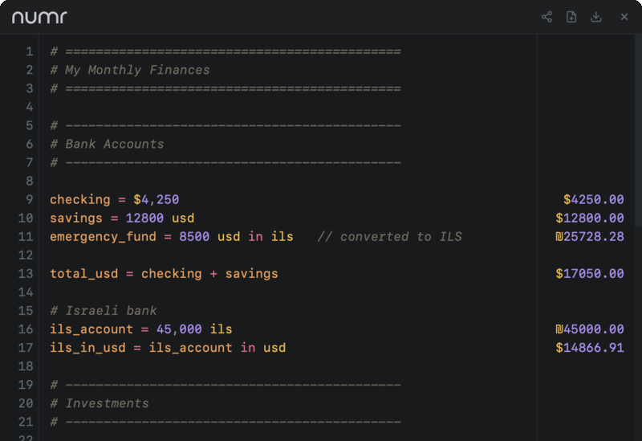

<p align="center">
  
</p>

<p align="center">
  <a href="https://github.com/nasedkinpv/numr-web/actions/workflows/ci.yml"></a>
</p>

The web and desktop interface for [numr](https://github.com/nasedkinpv/numr), powered by the `numr-core` and `numr-editor` WebAssembly packages.

<p align="center">
  <strong><a href="https://numr.cc">Try it online →</a></strong>
</p>

<p align="center">
  
</p>

## Features

- Real-time document evaluation with syntax highlighting
- Variables, continuations, percentages, functions, units, and currencies
- Grouped totals with cached fiat and crypto exchange rates
- Local persistence, self-contained share links, and `.numr` file import/export
- Responsive line wrapping, optional line numbers, and aligned results
- Reusable `<numr-calculator>` custom element with TypeScript declarations
- Shared runtime for the web app and native Electrobun desktop shell

## Web Component

Use `<numr-calculator>` on any page:

```html
<script type="module" src="https://numr.cc/numr-calculator.js?v=0e0b64d72d"></script>

<numr-calculator autosave></numr-calculator>
```

The package is self-contained: keep `numr-calculator.js`, `pkg/core`, and `pkg/editor` together, or point `base-path` to an equivalent layout. No runtime CDN dependencies are required.

### Attributes

| Attribute | Description |
|---|---|
| `content` | Initial document content |
| `minimal` | Hide the header and footer |
| `readonly` | Make the editor non-editable |
| `wrap` | Wrap long editor lines |
| `norates` | Skip cached and network exchange-rate loading |
| `autosave` | Persist the document to `localStorage` |
| `storage-key` | Override the autosave key |
| `base-path` | Override the URL containing `pkg/core` and `pkg/editor` |

### JavaScript API

```js
const calculator = document.querySelector("numr-calculator");

calculator.getContent();
calculator.setContent("price = $100\n+ 20%");
calculator.clear();
calculator.refreshRates();
calculator.focus();
```

The component emits:

- `numr-ready` when WASM initialization completes
- `numr-change` when content or evaluation changes, with `{ content, results, totals }` in `event.detail`

### Theming

```css
numr-calculator {
  --numr-bg-primary: #1a1c1e;
  --numr-bg-secondary: #1f2225;
  --numr-text-primary: #e8eaed;
  --numr-text-muted: #6b7280;
  --numr-accent: #eceef4;
  --numr-success: #7dd3a8;
  --numr-error: #f4a8a8;
  --numr-border: #2a2e32;
  --numr-selection: rgba(236, 238, 244, 0.22);
  --numr-token-number: #b898f4;
  --numr-token-operator: #f47898;
  --numr-token-variable: #f4a860;
  --numr-token-unit: #f4e878;
  --numr-token-currency: #f4c244;
  --numr-token-comment: #7d7868;
  --numr-token-text: #eceef4;
  --numr-token-punctuation: #a8a498;
}
```

Typography uses `--numr-font`, `--numr-font-mono`, `--numr-font-size`, and `--numr-line-height`. The open shadow root exposes the `container`, `header`, `editor`, and `footer` CSS parts.

## Local Development

`numr-web` is a separate repository, but its build expects the main Rust workspace beside it:

```bash
git clone https://github.com/nasedkinpv/numr.git
git clone https://github.com/nasedkinpv/numr-web.git numr/numr-web
cd numr/numr-web
bun install
```

### Prerequisites

- Rust 1.88 or newer with the `wasm32-unknown-unknown` target
- [wasm-pack](https://rustwasm.github.io/wasm-pack/installer/)
- Node.js 24 or newer
- Bun 1.3 or newer
- Playwright Chromium and WebKit (`npx playwright install chromium webkit`)

### Run the web app

The committed `pkg/` directory is ready to serve:

```bash
npm run check
npm run serve
# http://localhost:8080
```

Rebuild everything after changing `numr-core` or `numr-editor`:

```bash
npm run build
npm run test:browser
```

For JavaScript or CSS changes, `npm run build:frontend` rebuilds the browser bundles and asset stamps without rebuilding WASM.

### Run the desktop app

```bash
# Fast loop using the committed WASM packages
npm run desktop:dev

# Rebuild WASM first
npm run desktop:dev:fresh

# Reproducible stable package
npm run desktop:build
```

The desktop shell uses a frameless, rounded window and a tray menu. On macOS it runs as an accessory app without a Dock icon. Web and desktop settings persist independently in their respective storage origins.

## Architecture

The standalone app, desktop view, and custom element share one browser runtime:

- `NumrEditor` owns the CodeMirror document, native keymap, history, wrapping, line numbers, viewport highlighting, result anchoring, and scrolling.
- `NumrSession` adapts the generated WASM classes to plain JavaScript values.
- `RatesService` handles cached rates, request timeouts, partial-provider success, and coalesced refreshes.
- `storage` provides best-effort persistence for documents, settings, component autosave, and rate caches.
- `token-view` turns trusted tokenizer output into safe DOM nodes and CodeMirror decorations.
- `wasm-loader` shares module imports and permits retries after failed imports.

The custom element uses the same `NumrEditor`; it is not a separate editor implementation. Bun bundles local CodeMirror dependencies into the committed browser entrypoints, so deployed builds have no runtime CDN dependency.

## Repository Layout

```text
numr-web/
├── app.js                    # Standalone app bundle
├── numr-calculator.js        # Reusable custom-element bundle
├── numr-calculator.d.ts      # TypeScript public interface
├── desktop/                  # Electrobun assets
├── src/
│   ├── web/app.js            # Standalone and desktop product shell
│   ├── component/            # Custom element
│   └── shared/               # Editor, session, rates, storage, tokens, WASM loader
├── tests/                    # Contract and browser tests
├── scripts/                  # Build, version, and asset tooling
└── pkg/
    ├── core/                 # Generated numr-core WASM package
    └── editor/               # Generated numr-editor WASM package
```

Generated `pkg/` bindings and asset stamps are committed. CI verifies those deployable artifacts before rebuilding both locked WASM packages and checking the generated contracts again.

## Docker

```bash
docker build -t numr-web .
docker run -p 3000:3000 numr-web
```

## License

[MIT](https://github.com/nasedkinpv/numr/blob/master/LICENSE)
