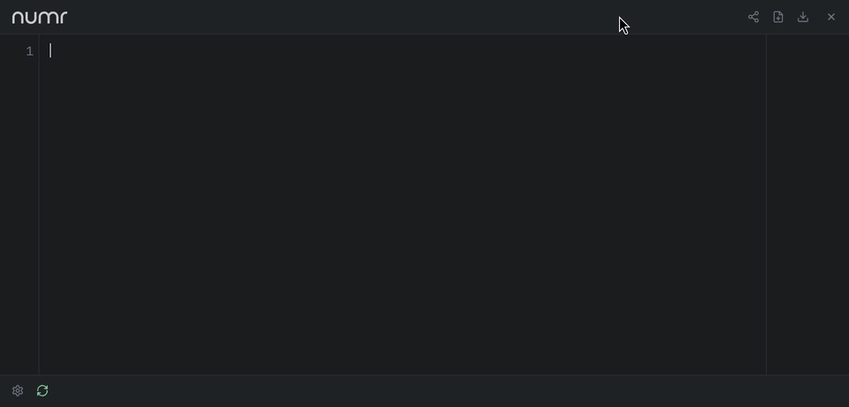

<p align="center">
  
</p>

<p align="center">
  <a href="https://github.com/nasedkinpv/numr-web/actions/workflows/ci.yml"></a>
</p>

The web interface for [numr](https://github.com/nasedkinpv/numr), powered by the `numr-core` and `numr-editor` WebAssembly packages. The desktop app in [numr-desktop](https://github.com/nasedkinpv/numr-desktop) wraps this same runtime in a Tauri shell.

<p align="center">
  <strong><a href="https://numr.cc">Try it online →</a></strong>
</p>

<p align="center">
  
</p>

## Features

- Real-time document evaluation with syntax highlighting
- Variables, continuations, percentages, functions, units, and currencies
- Grouped totals with cached fiat and crypto exchange rates
- Local persistence, self-contained share links, and `.numr` file import/export
- Responsive line wrapping, optional line numbers, and aligned results
- Reusable `<numr-calculator>` custom element with TypeScript declarations
- Shared runtime for the web app, the `<numr-calculator>` element, and the numr-desktop Tauri shell

## Web Component

Use `<numr-calculator>` on any page:

```html
<script type="module" src="https://numr.cc/numr-calculator.js?v=7658eae811"></script>

<numr-calculator autosave></numr-calculator>
```

The package is self-contained: keep `numr-calculator.js`, `pkg/core`, and `pkg/editor` together, or point `base-path` to an equivalent layout. No runtime CDN dependencies are required.

### Attributes

| Attribute | Description |
|---|---|
| `content` | Initial document content |
| `minimal` | Hide the header and footer |
| `readonly` | Make the editor non-editable |
| `wrap` | Wrap long editor lines |
| `decimal-places` | Display precision, integer `0`–`28`; omit (or use an empty value) for automatic legacy formatting |
| `norates` | Skip cached and network exchange-rate loading |
| `autosave` | Persist the document to `localStorage` |
| `storage-key` | Override the autosave key |
| `base-path` | Override the URL containing `pkg/core` and `pkg/editor` |

### JavaScript API

```js
const calculator = document.querySelector("numr-calculator");

calculator.getContent();
calculator.setContent("price = $100\n+ 20%");
calculator.clear();
calculator.refreshRates();
calculator.focus();
calculator.decimalPlaces = 4;         // re-evaluate without editing the document
calculator.decimalPlaces = undefined; // restore automatic formatting
```

The `decimalPlaces` property accepts only integer numbers from 0 to 28 or `undefined`; invalid assignments throw `RangeError`. Invalid `decimal-places` attributes are rejected with a console warning and the previous valid attribute is restored. Precision is local to each component and is not loaded from or saved to the standalone app preference. It changes display rounding only, not stored arithmetic, content, selection, or undo history.

The settings panel (gear button in the footer) holds line numbers, line wrapping, and the display precision; an empty precision field (`Auto`) restores the original value-specific formatting. This preference persists independently of the document; resetting it removes the saved override. Corrupt or unavailable storage falls back to `Auto`.

The component emits:

- `numr-ready` when WASM initialization completes
- `numr-change` when content or evaluation changes, with `{ content, results, totals }` in `event.detail`

### Theming

```css
numr-calculator {
  --numr-bg-primary: #1a1c1e;
  --numr-bg-secondary: #1f2225;
  --numr-text-primary: #e8eaed;
  --numr-text-muted: #6b7280;
  --numr-accent: #eceef4;
  --numr-success: #7dd3a8;
  --numr-error: #f4a8a8;
  --numr-border: #2a2e32;
  --numr-selection: rgba(236, 238, 244, 0.22);
  --numr-token-number: #b898f4;
  --numr-token-operator: #f47898;
  --numr-token-variable: #f4a860;
  --numr-token-unit: #f4e878;
  --numr-token-currency: #f4c244;
  --numr-token-comment: #7d7868;
  --numr-token-text: #eceef4;
  --numr-token-punctuation: #a8a498;
}
```

Typography uses `--numr-font`, `--numr-font-mono`, `--numr-font-size`, and `--numr-line-height`. The open shadow root exposes the `container`, `header`, `editor`, and `footer` CSS parts.

## Local Development

`numr-web` is a separate repository, but its build expects the main Rust workspace beside it:

```bash
git clone https://github.com/nasedkinpv/numr.git
git clone https://github.com/nasedkinpv/numr-web.git numr/numr-web
cd numr/numr-web
bun install
```

### Prerequisites

- Rust 1.88 or newer with the `wasm32-unknown-unknown` target
- [wasm-pack](https://rustwasm.github.io/wasm-pack/installer/)
- Node.js 24 or newer
- Bun 1.3 or newer
- Playwright Chromium and WebKit (`npx playwright install chromium webkit`)

### Run the web app

The committed `pkg/` directory is ready to serve:

```bash
npm run check
npm run serve
# http://localhost:8080
```

Rebuild everything after changing `numr-core` or `numr-editor`:

```bash
npm run build
npm run test:browser
```

For JavaScript or CSS changes, `npm run build:frontend` rebuilds the browser bundles and asset stamps without rebuilding WASM.

### Desktop surface

`desktop/` holds the desktop HTML, its CSS overrides, and `desktop/index.js`, the bridge that connects the shared `app.js` to the Tauri shell through `window.__TAURI__`. The shell itself, packaging, and releases live in [numr-desktop](https://github.com/nasedkinpv/numr-desktop), which pins this repository as a git submodule. To run the desktop app against a local checkout:

```bash
cd ../numr-desktop
NUMR_WEB_DIR=../numr-web cargo tauri dev
```

## Architecture

The standalone app, desktop view, and custom element share one browser runtime:

- `NumrEditor` owns the CodeMirror document, native keymap, history, wrapping, line numbers, viewport highlighting, result anchoring, and scrolling.
- `NumrSession` adapts the generated WASM classes to plain JavaScript values.
- `RatesService` handles cached rates, request timeouts, partial-provider success, and coalesced refreshes.
- `storage` provides best-effort persistence for documents, settings, component autosave, and rate caches.
- `token-view` turns trusted tokenizer output into safe DOM nodes and CodeMirror decorations.
- `wasm-loader` shares module imports and permits retries after failed imports.

The custom element uses the same `NumrEditor`; it is not a separate editor implementation. Bun bundles local CodeMirror dependencies into the committed browser entrypoints, so deployed builds have no runtime CDN dependency.

## Repository Layout

```text
numr-web/
├── app.js                    # Standalone app bundle
├── numr-calculator.js        # Reusable custom-element bundle
├── numr-calculator.d.ts      # TypeScript public interface
├── desktop/                  # Desktop HTML, CSS, and Tauri bridge (used by numr-desktop)
├── src/
│   ├── web/app.js            # Standalone and desktop product shell
│   ├── component/            # Custom element
│   └── shared/               # Editor, session, rates, storage, tokens, WASM loader
├── tests/                    # Contract and browser tests
├── scripts/                  # Build, version, and asset tooling
└── pkg/
    ├── core/                 # Generated numr-core WASM package
    └── editor/               # Generated numr-editor WASM package
```

Generated `pkg/` bindings and asset stamps are committed. CI verifies those deployable artifacts before rebuilding both locked WASM packages and checking the generated contracts again.

## Docker

```bash
docker build -t numr-web .
docker run -p 3000:3000 numr-web
```

## License

[MIT](https://github.com/nasedkinpv/numr/blob/master/LICENSE)
